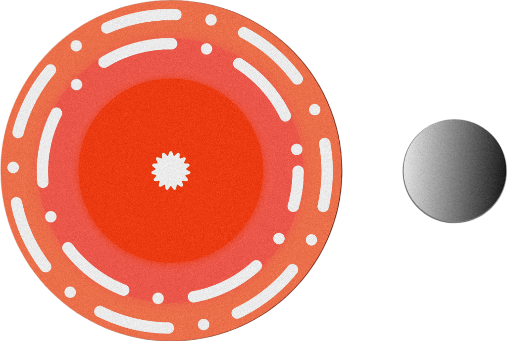
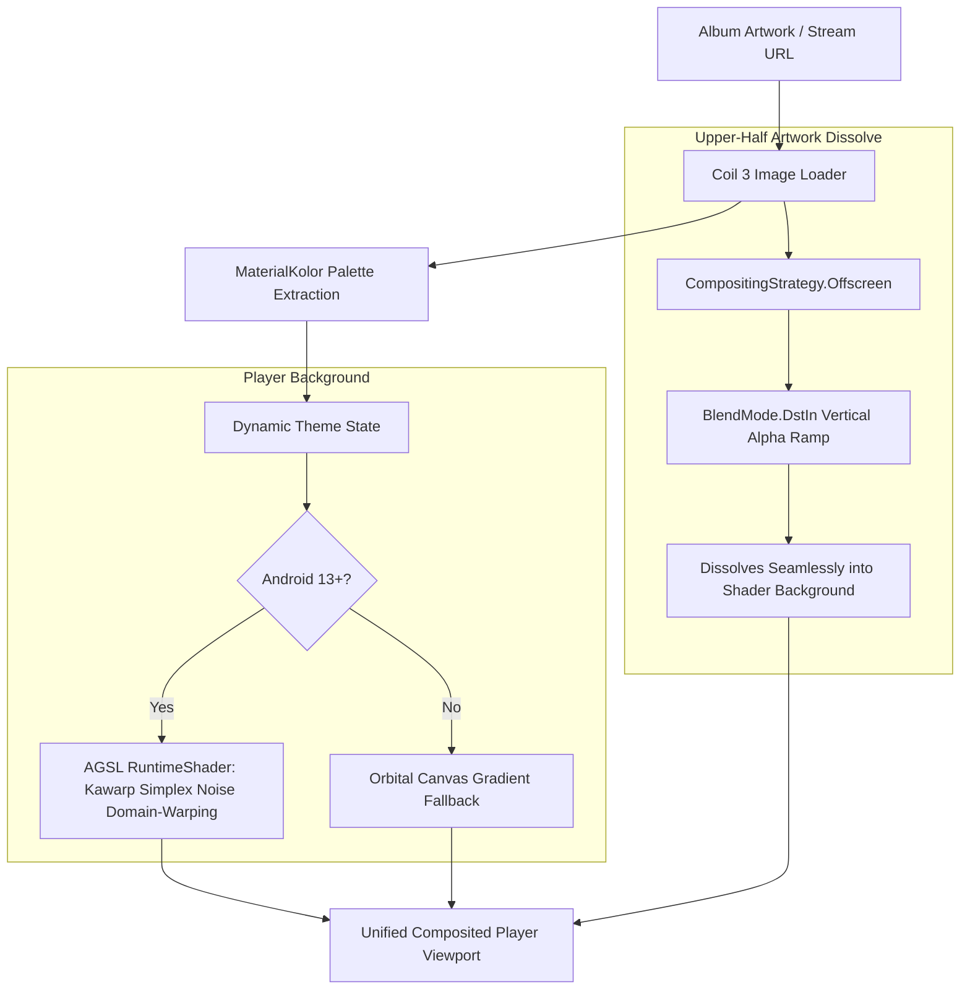
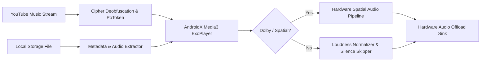

<div align="center">



# Mercury Music

### Next-Generation YouTube & Local Music Player for Android

An open-source, ad-free, privacy-respecting music streaming client engineered with Material 3 expressive design, dynamic AGSL hardware shaders, seamless portrait artwork dissolve, and an audiophile-grade offline media suite.

<br/>

[](https://github.com/CoderBhoid/mercury-music/releases)
[](https://www.android.com)
[](LICENSE)
[](https://github.com/CoderBhoid/mercury-music/actions)
[](https://sednium.com/donate)

<br/>

<a href="https://github.com/CoderBhoid/mercury-music/releases">
  
</a>
&nbsp;&nbsp;
<a href="https://sednium.com/donate">
  
</a>

<br/><br/>

[**Visual Showcase**](#-visual-showcase) • [**Getting Started**](#-getting-started) • [**Features & Highlights**](#-features--highlights) • [**Architecture**](#-architecture-overview) • [**Building from Source**](#-building-from-source) • [**Troubleshooting**](#-troubleshooting--faq) • [**Credits**](#-inspirations--credits)

</div>

---

## 📱 Visual Showcase

> [!TIP]
> Experience fluid 120Hz animations, hardware-accelerated AGSL canvas domain-warping, and immersive edge-to-edge typography.

<div align="center">

| Fullscreen Player (AGSL Shader) | Orbital Dock Navigation | Syllable-Synced Lyrics |
| :---: | :---: | :---: |
|  |  |  |
| *Hardware-composited upper artwork dissolve & live palette shader* | *Bespoke floating glass dock with spring physics & squircle indicators* | *Sub-second word/syllable synced lyrics with Romanization* |

| Offline Library & Local Media | 4K YouTube Downloader | Audiophile Audio Engine |
| :---: | :---: | :---: |
|  |  |  |
| *Automated storage scan, ID3 tags & local MP3 export* | *Direct up to 4K video downloads & raw high-bitrate audio extraction* | *Hardware audio offloading, Dolby Atmos & crossfade engine* |

</div>

---

## 🚀 Getting Started

### 📦 Installation

Pre-compiled official binaries (`.apk`) are distributed through the repository's **[Releases](https://github.com/CoderBhoid/mercury-music/releases)** page.

1. **Download the APK**: Download the latest release asset `Mercury-Music-v1.apk` (or `app-foss-debug.apk`).
2. **Allow Installation**:
   - Open the downloaded `.apk` from your device notification shade or file manager.
   - If prompted by Android, grant **"Install unknown apps"** permission for your browser or file manager (available across Android 8.0 Oreo through Android 15+).
3. **Launch Mercury**: Tap **Install** and launch Mercury Music from your app drawer.

---

### 🎧 First-Time Setup & Configuration

- **Choose Your Typography**:
  Navigate to **Settings** > **Appearance** > **App typography** to toggle between:
  - **Mercury Premium** (*Playfair Display* editorial headers + *Urbanist* modern geometric body)
  - **Urbanist Clean** (*Urbanist* geometric sans throughout)
  - **System Default** (inherits your operating system's configured font)
- **Select Player Aesthetics**:
  In **Settings** > **Appearance**, enable **Dynamic Theme**, choose your preferred **Slider Style** (Default, Squiggly wavy, or Slim), and select your navigation mode (**Mercury Orbital Dock** standard or slim).
- **Import Existing Playlists**:
  Open the **Library** or **Local** tab and tap **Import Playlist** to import your playlists from **Spotify** or **YouTube Music** via URL share link.
- **Configure Audio Offload & Quality**:
  Navigate to **Settings** > **Player** to configure streaming audio bitrate, crossfade duration, silence skipping, volume normalization, and hardware audio offloading.

---

## 🌟 Features & Highlights

<table>
  <tr>
    <td width="50%" valign="top">

### 🎨 Signature Aesthetics & Shaders
- **Kawarp AGSL Dynamic Simplex Background**: On Android 13+ (API 33+), the full-screen player runs hardware-accelerated domain-warped simplex noise shaders reacting in real time to the track's color palette, paired with a 60fps orbital canvas fallback for older devices.
- **Upper-Half Artwork Dissolve**: Portrait album artwork fills the upper half of the screen and seamlessly dissolves into the animated background using calibrated PorterDuff `DstIn` alpha compositing.
- **Mercury "Orbital Dock" Navigation**: Bespoke floating glass dock navigation with active illuminated squircle indicators, micro-dot markers, and fluid spring physics.
- **Lucide Icons**: Uniform, crisp, modern 24dp vector iconography integrated across playback controls, navigation, and settings.
- **Pure Black OLED Mode**: Deep true-black `#000000` surface themes optimized for battery conservation on OLED and AMOLED displays.

</td>
    <td width="50%" valign="top">

### ⚡ Offline Suite & Media Engine
- **4K YouTube Video & Audio Downloader**: Download YouTube videos up to 4K resolution or extract high-bitrate audio (MP3/M4A) directly into local device storage.
- **Dedicated Local Music Player**: Complete offline library support with automated audio directory scanning, ID3 metadata tags, album art caching, and built-in MP3 export.
- **Spotify & YouTube Playlist Importer**: Seamlessly import your playlists from Spotify and YouTube into your local Mercury library with a single URL.
- **Dolby Atmos & Spatial Audio Detection**: Real-time detection and dynamic badge indication for hardware-accelerated spatial audio and Dolby Atmos pipelines.
- **Full Offline Caching**: Automatically cache listened tracks or save entire albums/playlists for offline listening without cellular data.

</td>
  </tr>
  <tr>
    <td width="50%" valign="top">

### 🎼 Audiophile Playback Core
- **Media3 Playback Core**: Powered by AndroidX ExoPlayer/Media3 with hardware audio offload and low-latency buffer management.
- **Audio Normalization**: Consistent loudness across tracks with customizable loudness thresholds and ReplayGain support.
- **Seamless Crossfade & Gapless**: Transition smoothly between tracks with adjustable crossfade durations (1s to 12s).
- **Smart Silence Skipping**: Automatically detects and trims quiet pauses at the beginning or end of tracks.
- **Sleep Timer**: Flexible automatic playback timer with fade-out support and custom weekly schedules.

</td>
    <td width="50%" valign="top">

### 📝 Lyrics & Cloud Sync
- **Time-Synced & Romaji Lyrics**: Syllable- and word-level synced lyrics powered by Better Lyrics, Musixmatch, and Krc.
- **Interactive Lyrics**: Tap on any lyrics line to jump playback directly to that exact timestamp.
- **Listen Together Rooms**: Synchronize music playback in real time with friends across shared rooms.
- **PoToken & Cipher Support**: Integrated YouTube cipher deobfuscation and PoToken generation for reliable streaming without playback halts.
- **Android Auto & Media Notification**: Comprehensive media controls and lock screen artwork with customizable notification actions.

</td>
  </tr>
</table>

---

## 🏗️ Architecture Overview

Mercury Music follows clean architecture principles built around **Jetpack Compose**, **AndroidX Media3**, and **Hilt Dependency Injection**.

```
mercury/
├── app/
│   ├── src/main/
│   │   ├── kotlin/com/metrolist/music/
│   │   │   ├── MainActivity.kt               # Root Activity, Edge-to-Edge & NavHost
│   │   │   ├── playback/                     # Media3 MusicService, Player Connection & Queue
│   │   │   ├── ui/
│   │   │   │   ├── component/                # Reusable Compose Widgets
│   │   │   │   │   ├── AppNavigation.kt      # Floating Mercury Orbital Dock
│   │   │   │   │   ├── DynamicBackgroundView # AGSL Kawarp Simplex Warping Shaders
│   │   │   │   │   ├── MercuryPlayerSlider.kt# Squiggly, Slim & Standard Seekbars
│   │   │   │   │   └── MercuryGlassModifiers # Haze Backdrop Glassmorphic Blur
│   │   │   │   ├── player/                   # Fullscreen Player, MiniPlayer & Queue
│   │   │   │   │   ├── Player.kt             # Player Scaffold & Dynamic Background
│   │   │   │   │   └── Thumbnail.kt          # Upper-Half PorterDuff DstIn Artwork Dissolve
│   │   │   │   ├── screens/                  # Home, Explore, Library, Search & Local
│   │   │   │   │   ├── HomeScreen.kt         # Obsidian Modern Feed & Recent Tracks
│   │   │   │   │   └── local/LocalMediaScreen# Offline Audio Scanner & MP3 Exporter
│   │   │   │   └── theme/                    # MaterialKolor Dynamic Palette & Typography
│   │   │   └── utils/                        # DolbyDetector, YouTubeDownloader, PlaylistImporter
│   │   └── res/                              # Vector Drawables, Lucide Icons & Variable Fonts
│   └── build.gradle.kts                      # App Module Dependencies & Build Config
└── innertube/                                # YouTube Music Extraction Engine & Cipher Deobfuscator
```

### Visual Rendering Pipeline



### Audio Playback Pipeline



---

## 🛠️ Building from Source

Mercury Music is built with **Kotlin 2.0+** and **Jetpack Compose** using the Gradle build system.

### Prerequisites

| Tool | Minimum Version | Recommended |
| :--- | :--- | :--- |
| **Android Studio** | Ladybug (2024.2.1+) | Latest Stable |
| **JDK** | Java 17 | Eclipse Temurin JDK 17 / 21 |
| **Android SDK** | API 35 (VanillaIceCream) | Build Tools 35.0.0+ |
| **Git** | 2.30+ | Latest Stable |

### Step-by-Step Build Instructions

```bash
# 1. Clone the repository
git clone https://github.com/CoderBhoid/mercury-music.git
cd mercury-music

# 2. Grant executable permissions to Gradle wrapper (Linux / macOS)
chmod +x ./gradlew

# 3. Compile and assemble the FOSS Debug APK
./gradlew :app:assembleFossDebug

# 4. The generated APK will be available at:
# app/build/outputs/apk/foss/debug/app-foss-debug.apk
```

### Direct ADB Installation to Connected Phone

If your Android device has **USB Debugging** enabled:

```bash
# Verify device connection
adb devices -l

# Install the freshly built APK with replace flag (-r)
adb install -r app/build/outputs/apk/foss/debug/app-foss-debug.apk
```

---

## 📋 Available Gradle Commands

| Command | Purpose |
| :--- | :--- |
| `./gradlew :app:assembleFossDebug` | Builds the debug FOSS APK for local testing and daily driving |
| `./gradlew :app:assembleFossRelease` | Builds the optimized production APK (requires keystore signing) |
| `./gradlew :app:lintFossDebug` | Runs Android Lint static analysis across the app codebase |
| `./gradlew test` | Executes unit tests across modules |
| `./gradlew clean` | Cleans the Gradle build cache and intermediate outputs |

---

## 🔍 Troubleshooting & FAQ

### 1. Playback halts or stops when the screen is locked
- **Cause**: Aggressive OEM battery management (MIUI, OxygenOS, OneUI) throttling background services.
- **Solution**: Go to your device **Settings** > **Apps** > **Mercury Music** > **Battery** > Set to **"Unrestricted"** / **"Don't optimize"**.

### 2. Audio stuttering or high latency
- **Solution**: Open **Settings** > **Player** > **Audio offload** and toggle the hardware offloading option. If your device DSP has compatibility issues, software decoding provides jitter-free playback.

### 3. YouTube stream loading errors or 403 Forbidden
- **Solution**: Mercury integrates active YouTube cipher deobfuscation and PoToken refresh. Ensure you are on the latest release, or enable **Settings** > **Integrations** > **PoToken Provider** to refresh token credentials.

### 4. Spotify playlist import fails
- **Solution**: Ensure your Spotify playlist is set to **Public** or **Shared**. In Spotify, tap **Share** > **Copy link**, then paste the full `https://open.spotify.com/playlist/...` URL into Mercury's playlist importer.

---

## 💡 Inspirations & Credits

Mercury Music is made possible thanks to the creativity and dedication of the open-source music community:

### 🌟 [Obsidian Music](https://github.com/Varun7009/Obsidian-Music)
Deep appreciation and credit to **[Varun7009](https://github.com/Varun7009)** for the groundbreaking design language, fluid player concepts, and aesthetic direction of **Obsidian Music**. Mercury takes direct inspiration from Obsidian's bold vision and expands upon it with refined glassmorphism, bespoke dock navigation, and customized shader rendering.

### 🎵 [Metrolist](https://github.com/MetrolistGroup/Metrolist)
Sincere gratitude to the **Metrolist** team and community for providing the resilient open-source YouTube Music playback foundation, streaming backend, and Material 3 structure.

### 🎼 [InnerTune](https://github.com/z-huang/InnerTune) & [OuterTune](https://github.com/DD3Boh/OuterTune)
Heartfelt thanks to **Zion Huang**, **Malopieds**, **Davide Garberi**, and the InnerTune/OuterTune contributors who pioneered open-source Android YouTube Music streaming.

### 📚 Open-Source Dependencies
- **[Jetpack Compose & Material 3](https://developer.android.com/jetpack/compose)**: Modern declarative UI toolkit.
- **[AndroidX Media3](https://developer.android.com/media/media3)**: Advanced media playback and ExoPlayer engine.
- **[Coil 3](https://coil-kt.github.io/coil/)**: Lightweight image loading for Kotlin Coroutines.
- **[MaterialKolor](https://github.com/jordond/MaterialKolor)**: Dynamic M3 color palette extraction.
- **[Haze](https://github.com/chrisbanes/haze)**: Glassmorphic real-time backdrop blurring for Compose.
- **[Lucide Icons](https://lucide.dev)**: Clean, consistent open-source iconography.
- **[Better Lyrics](https://better-lyrics.boidu.dev)**: Synced lyrics data source and formatting.

---

## 🤝 Code of Conduct & Contributing

### Our Pledge
We are committed to providing a welcoming, diverse, and harassment-free environment for everyone. We welcome contributions from developers of all skill levels.

### How to Contribute
1. Fork the repository on GitHub.
2. Create a new branch: `git checkout -b feat/your-feature-name`.
3. Test your changes locally: `./gradlew :app:assembleFossDebug`.
4. Ensure your commits follow conventional commits (`feat(player): add squiggly slider option`).
5. Open a Pull Request with a clear description and screenshots/recordings of UI changes.

---

## 💖 Support Development

Developing and maintaining Mercury Music as a free, open-source, ad-free project requires continuous development time, testing across diverse hardware, and reverse-engineering infrastructure.

If you enjoy using Mercury Music, please consider supporting development:

<div align="center">

<br/>

<a href="https://sednium.com/donate">
  
</a>

### 🌐 [sednium.com/donate](https://sednium.com/donate)

<br/>

**This project stands with humanity 🌍**

</div>
